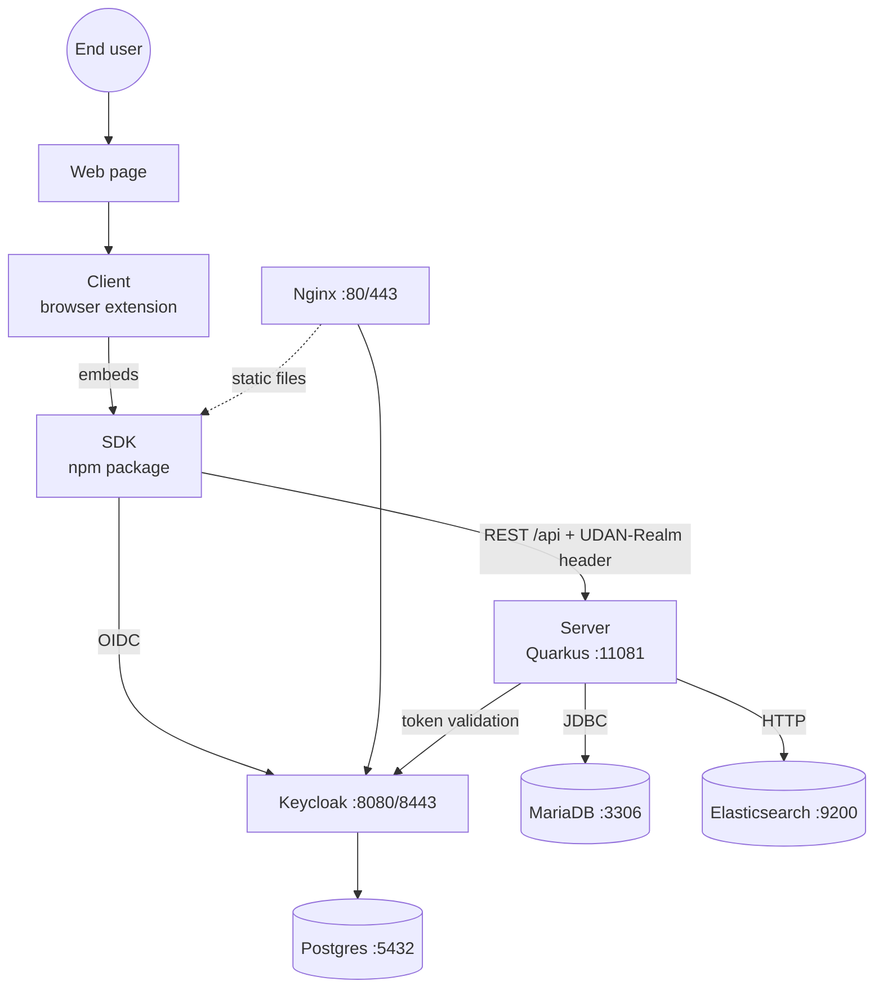

# UDAN overview

This page shows how the public parts of UDAN fit together. It is for an engineer who is new to UDAN and wants the
whole picture before working in one repository. Each repository's own docs hold its internals; this page links to
them.

UDAN (Universal Digital Assistant) records click sequences on a web page and replays them for other users. A
browser extension (the Client) embeds a browser library (the SDK). The SDK sends recordings to a REST API (the
Server), which stores and searches them. Keycloak signs users in.

## Containers

This diagram shows the public containers and the shared infrastructure, with the protocol on each connection.

## Components

| Component | Repository | Technology | Role |
|---|---|---|---|
| Server | [`Digital-Assistant-Server`][server] | Quarkus, Java 21, Gradle, Flyway, Hibernate Search | REST API under `/api`: click sequences, search, votes, status, users |
| Client | [`Digital_Assistant_Client`][client] | TypeScript, webpack, Chrome Manifest V3 | Browser extension: the panel users see, content scripts, background worker |
| SDK | [`Digital-Assistant-SDK`][sdk] | TypeScript, Redux Toolkit, webpack | Records and replays sequences, calls the Server; published to npm |
| Shared infrastructure | workspace `infra/` (planned) | Nginx, Keycloak, MariaDB, Postgres, Elasticsearch | Local services the Server and the SDK need ([page](containers/infra.md)) |

## Facts that cross repositories

| Fact | Value | Where it is set |
|---|---|---|
| Server port | `11081` | Server `application.properties` |
| Server REST base path | `/api`, for example `/api/search/all` | Server `RestApplication` (`@ApplicationPath("/api")`) |
| Tenant selection | Request header `UDAN-Realm`; no default; a missing header gives `400` | Server `CustomTenantResolver`, `RequireRealmFilter` |
| Keycloak realms | `UDAN`; `UDAN-Plugin` (the extension's realm) | Keycloak realm import, Server `%dev` tenants |
| Public sign-in client | `udan-extension` in realm `UDAN-Plugin`: authorization code + PKCE, no secret | Keycloak realm, Client build setting `keycloakPublicClientId` |
| CORS header | The Server must allow the request header `udan-realm` | Server CORS settings |
| SDK version in the Client | Exact version pinned in the Client's `package.json`; no local linking | Client `package.json` |

A change to one of these facts affects more than one repository. List the affected repositories in the pull
request.

## Read next

| Topic | Page |
|---|---|
| One component | [Server](containers/server.md), [Client](containers/client.md), [SDK](containers/sdk.md), [infrastructure](containers/infra.md) |
| Database tables and search indexes | [Data model](data-model.md) |
| Sign-in and tenant selection | [Flow: authentication](flows/auth-oidc.md) |
| Recording a sequence | [Flow: record a sequence](flows/record-sequence.md) |
| Search | [Flow: search](flows/search.md) |
| Decisions that cross repositories | [ADR index](adr/README.md) |
| Model of the containers | [`likec4/model.c4`](likec4/model.c4); view it with `npx likec4 start docs/likec4` |

[server]: https://github.com/Digital-Assistant/Digital-Assistant-Server/blob/dev/README.md
[client]: https://github.com/Digital-Assistant/Digital_Assistant_Client/blob/dev/README.md
[sdk]: https://github.com/Digital-Assistant/Digital-Assistant-SDK/blob/dev/README.md
