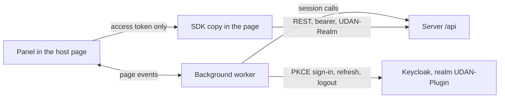

# Client

This page says what the Client is and how it connects to the other parts. It is for an engineer who works across
repositories. The Client's internals are in its own repository; this page links to them.

## Role

The Client is the UDAN browser extension for Chrome (Manifest V3). It holds the panel users see, the content
scripts and the background worker. The recording, playback and API logic come from the SDK, which the Client takes
from npm at an exact version. There is no local linking between the two repositories.

## Interfaces

| Interface | Value |
|---|---|
| SDK dependency | `@udan/digital-assistant-sdk`, exact version in `package.json` |
| Build settings | `environments/<build>.env`, schema in `environments/env.example`; public values only |
| Sign-in | In the background worker: Keycloak authorization code + PKCE on the public client `udan-extension` |
| Server calls | Through the SDK, with a bearer token and the `UDAN-Realm` header |
| Extension origin | `chrome-extension://<extension-id>`; the Server's CORS settings must allow it |

## How it connects

This diagram shows the Client's parts and the services they call.

The refresh token stays in the worker. The panel gets the short-lived access token only and asks the worker to
renew it.

## Where to read more

| Topic | Client page |
|---|---|
| Build, build settings, TEST or PROD at runtime, loading the extension | [`README.md`][readme] |
| Sign-in paths, where tokens live, CORS needs | [`README.md`, "Sign-in and where the config lives"][signin] |
| Testing a change against a local stack | [`README.md`, "Testing a change locally"][test] |
| Rules for AI agents, the public-repository rule | [`AGENTS.md`][agents] |

Cross-repository pages in this workspace: [authentication](../flows/auth-oidc.md), [SDK](sdk.md).

[readme]: https://github.com/Digital-Assistant/Digital_Assistant_Client/blob/dev/README.md
[signin]: https://github.com/Digital-Assistant/Digital_Assistant_Client/blob/dev/README.md#sign-in-and-where-the-config-lives
[test]: https://github.com/Digital-Assistant/Digital_Assistant_Client/blob/dev/README.md#testing-a-change-locally
[agents]: https://github.com/Digital-Assistant/Digital_Assistant_Client/blob/dev/AGENTS.md
