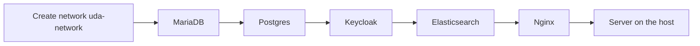

# Shared local infrastructure

This page lists the services the Server and the SDK need on a developer machine. It is for an engineer who sets
up or debugs the local stack.

> [!NOTE]
> Planned. The workspace `infra/` folder and the `./udan up infra` command arrive in a later phase of the workspace
> setup. Until then the services run from an infrastructure setup outside this repository. The services, images and
> ports below are the ones that setup uses today, and `infra/` keeps them.

## Services

| Service | Container | Image | Ports | Role |
|---|---|---|---|---|
| Nginx | `nginx-local` | nginx 1.24.0 | 80, 443 | TLS termination, routing by host name to Keycloak, static SDK files |
| Keycloak | `keycloak-local` | `quay.io/keycloak/keycloak` 23.0.0 | 8080, 8443 | Identity provider; health at `/health/live` |
| Postgres | `postgres-local` | postgres 14 | 5432 | Keycloak's database |
| MariaDB | `mariadb-local` | mariadb 10.11 | 3306 | Server data, database `udan` |
| Elasticsearch | `elasticsearch-local` | elasticsearch 7.17.16 | 9200 | Server search index |

The Server itself runs on the host, not in a container, on port 11081. Its start script checks these services
first: see the Server [`README.md`, "Getting Started"][server-start].

## Network and start order

All containers join the Docker network `uda-network`. The start order follows the dependencies:

Stop runs in the reverse order. Always start and stop the stack with the scripts, never with raw `docker` commands
([`AGENTS.md`](../../AGENTS.md), "Local stack").

## Certificates

The start step creates one self-signed development certificate when it is missing, unreadable or close to expiry.
Nginx and Keycloak use it for TLS, and MariaDB uses it for its TLS port. The services load the certificate at
start, so restart them after a new one is made. Certificates are never committed: the workspace `.gitignore`
ignores `certs/`, `*.pem`, `*.key` and `*.crt`.

## Keycloak realms

| Realm | Used by | Clients |
|---|---|---|
| `UDAN` | Server tenant `UDAN` | `backend-service` (confidential) |
| `UDAN-Plugin` | Server tenant `UDAN-Plugin`; the browser extension | `backend-service` (confidential, legacy sign-in), `udan-extension` (public, PKCE) |
| `master` | Keycloak administration | Keycloak defaults |

The public client `udan-extension` uses authorization code with PKCE (S256). It has no secret and no direct
grants. Its redirect URI is `https://<extension-id>.chromiumapp.org/*`. A realm import seeds only a fresh Keycloak:
a running Keycloak with an older realm keeps its clients until the realm is changed through the admin API or the
volume is wiped. Development credentials come from a local `.env` file and are never committed. The one
exception is the dev-only `backend-service` secret in the realm files; see
[the realms README](../../infra/keycloak/realms/README.md).

## Read next

- How the Server uses Keycloak: [Flow: authentication](../flows/auth-oidc.md).
- What the Server stores: [Data model](../data-model.md).

[server-start]: https://github.com/Digital-Assistant/Digital-Assistant-Server/blob/dev/README.md#-getting-started-local-development
