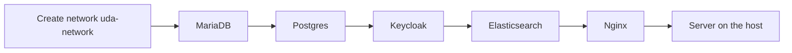

# Shared local infrastructure

This page lists the services the Server and the SDK need on a developer machine. It is for an engineer who sets
up or debugs the local stack.

The workspace [`infra/`](../../infra/README.md) folder holds the compose files, and `./udan` starts, stops and
checks them.

## Services

| Service | Container | Image | Ports | Role |
|---|---|---|---|---|
| Nginx | `nginx-local` | nginx 1.24.0 | 80, 443 | TLS termination, routing by host name to Keycloak, static SDK files |
| Keycloak | `keycloak-local` | `quay.io/keycloak/keycloak` 23.0.0 | 8080, 8443 | Identity provider; health at `/health/live` |
| Postgres | `postgres-local` | postgres 14 | 5432 | Keycloak's database |
| MariaDB | `mariadb-local` | mariadb 10.11 | 3306 | Server data, database `udan` |
| Elasticsearch | `elasticsearch-local` | elasticsearch 7.17.16 | 9200 | Server search index |

The Server itself runs on the host, not in a container, on port 11081. Its start script checks these services
first: see the Server [`README.md`, "Getting Started"][server-start].

## Commands

| Command | What it does |
|---|---|
| `./udan up infra` | Creates `infra/.env` and the certificate if missing, creates the network, then starts the services below in order. Running containers are left as they are. Exits 1 when MariaDB or Keycloak does not become ready |
| `./udan down` | Stops the stack's containers by name, in reverse order. Data stays in the volumes |
| `./udan status` | State and health of each container |
| `./udan doctor` | Checks tools, Docker, `infra/.env`, certificates, containers, ports, database and Keycloak logins, realms, Elasticsearch and the Server. Exits 1 on a failed check |
| `./udan reload nginx` | Runs `nginx -t` in the container, then reloads nginx |
| `./udan clean` | Checks that no other container uses the network or the volumes, asks, stops the stack, then removes its five containers, the network and its named volumes, by name. `infra/.env` and the certificates stay |

Add `--dry-run` to print the Docker commands instead of running them.

## Folder map

| Path | Content |
|---|---|
| `infra/<service>/docker-compose-<service>.yaml` | One compose file per service; the folder name is the compose project name |
| `infra/.env.example`, `infra/.env` | Dev settings and passwords. `.env` is created from the example and ignored by git |
| `infra/mariadb/init/`, `infra/postgres/init/` | First-start scripts that create the databases and users |
| `infra/keycloak/realms/` | Realm files imported into a fresh Keycloak |
| `infra/keycloak/conf/keycloak.conf` | Keycloak settings |
| `infra/nginx/conf.d/` | Nginx configuration; `extra/` takes extra `server` blocks |
| `infra/nginx/localhost/`, `infra/keycloak/certs/` | The generated dev certificate (ignored by git) |

## Network and start order

All containers join the Docker network `uda-network` (172.20.0.0/16). `./udan up infra` creates it when it is
missing. The start order follows the dependencies:

After each start `./udan` waits a fixed time: MariaDB 10 s, Postgres 5 s, Keycloak 15 s, Elasticsearch 10 s,
Nginx 2 s. After MariaDB it also waits until the user `udan` can run `SELECT 1` (30 tries, 2 s apart), and after
Keycloak until its health check reports healthy (90 tries, 2 s apart). If either does not become ready,
`./udan up infra` stops with exit code 1 and shows the container's last log lines. Stop runs in the reverse
order. Always start and stop the stack with `./udan`, never with raw `docker` commands
([`AGENTS.md`](../../AGENTS.md), "Local stack").

## Settings and passwords

`infra/.env` holds every password the stack uses. `./udan up infra` creates it from `infra/.env.example`, whose
values are dev-only placeholders. Each service gets only the variables it needs. `./udan` reads the file the way
Docker Compose does for a documented subset of the format: see [`infra/README.md`](../../infra/README.md#env-format).
The databases and Keycloak read these values only when their volume is new. A volume created earlier keeps its
own passwords. When `./udan doctor` reports a refused login (not one it could not check), either put the values
the volume was created with into `infra/.env`, or run `./udan clean` and start again.

## Certificates

`./udan up infra` runs `scripts/infra-certs.sh`, which creates one self-signed development certificate when it
is missing, unreadable or close to expiry. Nginx and Keycloak use it for TLS, and MariaDB uses it for its TLS
port. The services load the certificate at start, so restart them (`./udan down`, then `./udan up infra`) after
a new one is made. Certificates are never committed: the workspace `.gitignore`
ignores `certs/`, `*.pem`, `*.key` and `*.crt`.

## Keycloak realms

| Realm | Used by | Clients |
|---|---|---|
| `UDAN` | Server tenant `UDAN` | `backend-service` (confidential) |
| `UDAN-Plugin` | Server tenant `UDAN-Plugin`; the browser extension | `backend-service` (confidential, legacy sign-in), `udan-extension` (public, PKCE) |
| `master` | Keycloak administration | Keycloak defaults |

The realm files are in [`infra/keycloak/realms/`](../../infra/keycloak/realms/README.md). The public client
`udan-extension` uses authorization code with PKCE (S256). It has no secret and no direct
grants. Its redirect URI is `https://<extension-id>.chromiumapp.org/*`. A realm import seeds only a fresh Keycloak:
a running Keycloak with an older realm keeps its clients until the realm is changed through the admin API or the
volume is wiped. Development credentials come from a local `.env` file and are never committed. The one
exception is the dev-only `backend-service` secret in the realm files; see
[the realms README](../../infra/keycloak/realms/README.md).

## Extra routes

Another repository can add nginx routes without changing tracked files. It drops `*.conf` files with whole
`server` blocks into `infra/nginx/conf.d/extra/` (ignored by git), then runs `./udan reload nginx`. Nginx loads
that folder at every start. See [`infra/nginx/README.md`](../../infra/nginx/README.md).

## Read next

- How the Server uses Keycloak: [Flow: authentication](../flows/auth-oidc.md).
- What the Server stores: [Data model](../data-model.md).

[server-start]: https://github.com/Digital-Assistant/Digital-Assistant-Server/blob/dev/README.md#-getting-started-local-development
