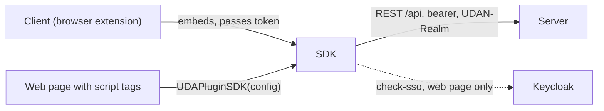

# SDK

This page says what the SDK is and how it connects to the other parts. It is for an engineer who works across
repositories. The SDK's internals are in its own repository; this page links to them.

## Role

The SDK is a browser library, published to npm as `@udan/digital-assistant-sdk`. It records and replays click and
hover sequences, keeps its state in one Redux store, and calls the Server through an HTTP client that adds the
bearer token and the `UDAN-Realm` header. The Client embeds it. Third parties can build their own interface on it,
which is why it stays a separate repository ([ADR 0001](../adr/0001-keep-separate-repos.md)).

## Interfaces

| Interface | Value |
|---|---|
| Package | `@udan/digital-assistant-sdk` on npm, ESM and CommonJS bundles in `dist/` |
| Host page globals | `UDAPluginSDK`, `UDAGlobalConfig`, `UDAAuthConfig`, `UDAAuthDataConfig` |
| Required settings | `realm` and `clientId`; without them the SDK sends no request |
| Token | A token the host passes with `setAuthToken` wins; otherwise Keycloak `check-sso` in a web page, when enabled |
| Server calls | REST under `/api` with a bearer token and the `UDAN-Realm` header |

## How it connects

This diagram shows the SDK's two kinds of host and the services it calls.

## Where to read more

| Topic | SDK page |
|---|---|
| What the SDK is, how to build it | [`README.md`][readme] |
| Host page setup, runtime keys, load order | [`USAGE.md`][usage] |
| Map of the code and one request end to end | [`docs/architecture/overview.md`][arch] |
| Decisions (build-time config, branches and releases, authentication, `dist/` in CI) | [`docs/adr/README.md`][adr] |
| Releases and promotion on npm | [`RELEASE_PROCESS.md`][release] |
| Rules for AI agents | [`AGENTS.md`][agents] |

Cross-repository pages in this workspace: [authentication](../flows/auth-oidc.md),
[record a sequence](../flows/record-sequence.md), [search](../flows/search.md), [Client](client.md).

[readme]: https://github.com/Digital-Assistant/Digital-Assistant-SDK/blob/dev/README.md
[usage]: https://github.com/Digital-Assistant/Digital-Assistant-SDK/blob/dev/USAGE.md
[arch]: https://github.com/Digital-Assistant/Digital-Assistant-SDK/blob/dev/docs/architecture/overview.md
[adr]: https://github.com/Digital-Assistant/Digital-Assistant-SDK/blob/dev/docs/adr/README.md
[release]: https://github.com/Digital-Assistant/Digital-Assistant-SDK/blob/dev/RELEASE_PROCESS.md
[agents]: https://github.com/Digital-Assistant/Digital-Assistant-SDK/blob/dev/AGENTS.md
