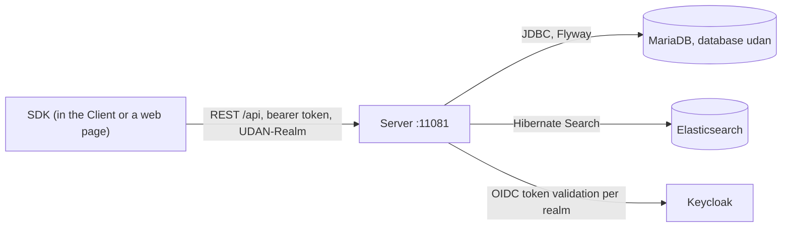

# Server

This page says what the Server is and how the other parts reach it. It is for an engineer who works across
repositories. The Server's internals (packages, conventions, decisions, configuration keys) are in its own
repository; this page links to them and does not repeat them.

## Role

The Server is the core REST API of UDAN. It records click sequences, serves search over them, and handles votes,
sequence status and the current user. It is a Quarkus application (Java 21, Gradle) that runs on the host on port
11081, not in a container.

## Interfaces

| Interface | Value |
|---|---|
| REST base path | `/api`, for example `http://localhost:11081/api/search/all` |
| REST roots | `/clickevents`, `/search`, `/searchTerms`, `/votes`, `/sequence`, `/status`, `/user`, `/users`, `/admin`, `/domain` |
| Authentication | Bearer token from Keycloak on every `/api/` path, with a few named exceptions |
| Tenant | Request header `UDAN-Realm` names the Keycloak realm; a missing header gives `400` |
| Health and metrics | `/q/health`, `/q/metrics`, outside `/api/`, no token |
| Container image | `ghcr.io/digital-assistant/udan-server` |

## How it connects

This diagram shows who calls the Server and what the Server calls.

The browser calls the Server from a `chrome-extension://` origin or from a customer site's origin, so the Server's
CORS settings must allow those origins and the `udan-realm` header.

## Where to read more

| Topic | Server page |
|---|---|
| Setup, start, configuration keys, authentication, ownership, CORS | [`README.md`][readme] |
| Map of the code, entry points, tenant flow | [`docs/architecture/overview.md`][arch] |
| Decisions (Flyway, tenant header, repositories, resources and services, secrets) | [`docs/adr/README.md`][adr] |
| Code rules | [`CONVENTIONS.md`][conv] |
| Build, test and the pre-merge gate | [`CONTRIBUTING.md`][contrib] |
| Rules for AI agents | [`AGENTS.md`][agents] |

Cross-repository pages in this workspace: [authentication](../flows/auth-oidc.md),
[record a sequence](../flows/record-sequence.md), [search](../flows/search.md), [data model](../data-model.md).

[readme]: https://github.com/Digital-Assistant/Digital-Assistant-Server/blob/dev/README.md
[arch]: https://github.com/Digital-Assistant/Digital-Assistant-Server/blob/dev/docs/architecture/overview.md
[adr]: https://github.com/Digital-Assistant/Digital-Assistant-Server/blob/dev/docs/adr/README.md
[conv]: https://github.com/Digital-Assistant/Digital-Assistant-Server/blob/dev/CONVENTIONS.md
[contrib]: https://github.com/Digital-Assistant/Digital-Assistant-Server/blob/dev/CONTRIBUTING.md
[agents]: https://github.com/Digital-Assistant/Digital-Assistant-Server/blob/dev/AGENTS.md
