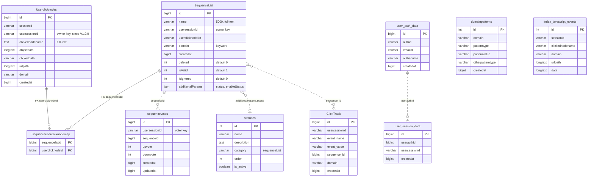

# Data model

This page shows the tables the Server keeps in MariaDB and the search indexes it builds from them. It is for an
engineer who reads or changes Server data, or who builds a client that depends on it.

Sources: the Server's JPA entities (package `models/`) and its Flyway migrations
`V1.0.0` to `V1.0.9` (`src/main/resources/db/migration/`). The column types are the ones the code and the
migrations declare. They were not checked against a live database.

## Server tables

The Server owns the database `udan` in MariaDB. Flyway creates and changes every table below when the Server
starts. Solid lines are database foreign keys; only `Sequenceuserclicknodemap` has them. Dotted lines are
references by value, with no constraint.

## Search indexes

Hibernate Search builds the Elasticsearch indexes `sequencelist`, `clicktrack` and `userclicknodes` from the
entities of the same names. The Server setting `udan.search.index-prefix` adds a prefix to each name, so two
environments can share one Elasticsearch. Writes reach the index in the same request (`write-sync`).

## Rules that matter to every client

| Rule | Detail |
|---|---|
| One sequence per click node | `Userclicknodes` maps many-to-one to `SequenceList` through `Sequenceuserclicknodemap` |
| Soft delete | Search returns only `SequenceList` rows with `deleted=0`, `isValid=1`, `isIgnored=0` |
| Status | Search returns published sequences (or ones with no status), plus the caller's own drafts |
| Status ids | `SequenceListStatus` looks up the "Draft" and "Published" ids in `statuses` at run time and caches them |
| Owner key | The `authid` for legacy users; otherwise the numeric `user_auth_data.id`. An all-digit value is always an id |
| Owner source | The Server sets every owner key from the caller's token, never from a request body |

## Schema ownership

1. Flyway applies the migrations at Server start (`migrate-at-start`). Hibernate does not generate tables
   (`generation=none`).
2. A Flyway `clean` or a schema reset drops every table in the database `udan`, not only the Server's tables.
3. The MariaDB init script of the shared infrastructure creates the databases `udan` and `keycloak`. Keycloak
   stores its data in Postgres, not in MariaDB.
4. `src/main/resources/pg/migration/` holds old Postgres copies of the first migrations. Flyway does not read that
   folder.

## Read next

- How a recording reaches these tables: [Flow: record a sequence](flows/record-sequence.md).
- How search reads them: [Flow: search](flows/search.md).
- The Server's decision on migrations: [Server ADR 0001][adr-flyway].

[adr-flyway]: https://github.com/Digital-Assistant/Digital-Assistant-Server/blob/dev/docs/adr/0001-flyway-for-schema-migrations.md
