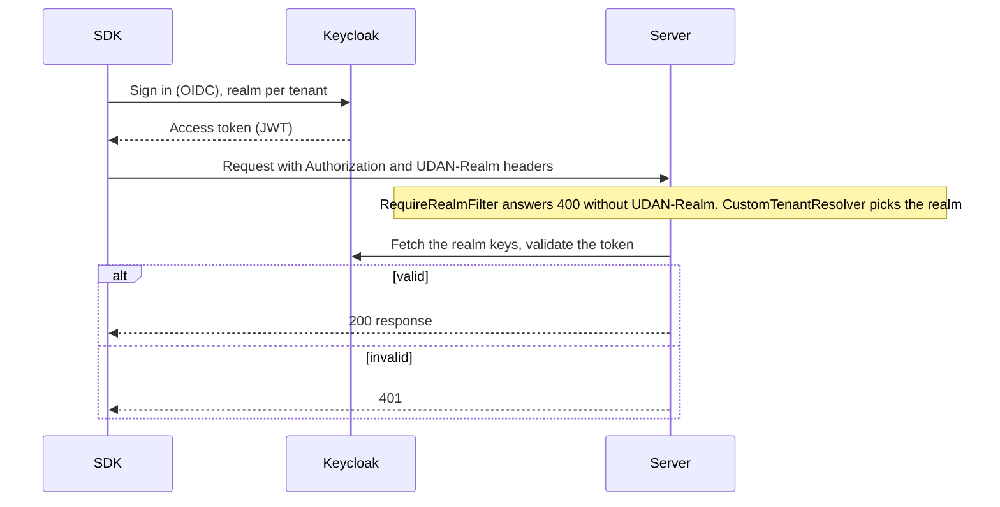
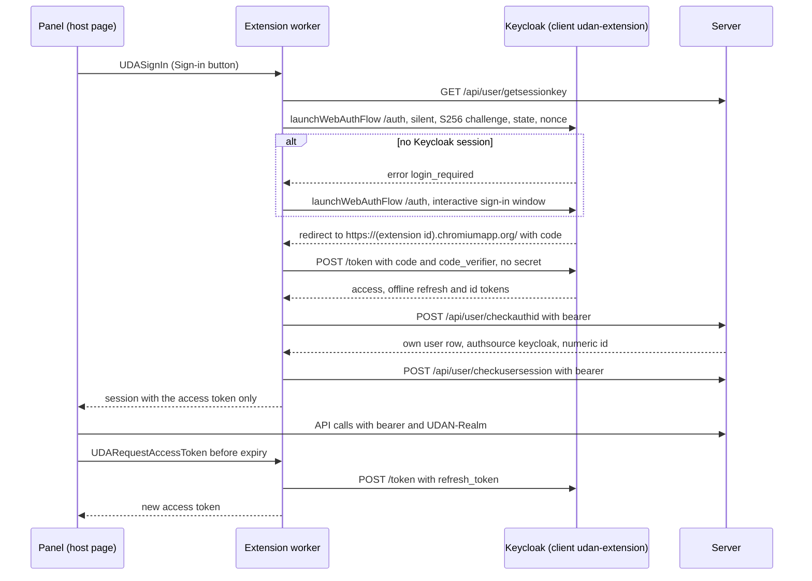

# Flow: authentication and tenant selection

This page shows how a user signs in, and how the Server checks the token and picks the Keycloak realm. It is for an
engineer who changes sign-in in the Client or the SDK, or token handling in the Server.

Sources: Server `config/CustomTenantResolver.java`, `config/RequireRealmFilter.java`, `users/CurrentUser.java` and
`application.properties`; Client `src/browser-auth/LoginWithKeycloak.ts`; SDK `src/services/apiClient.ts`.

## Every request to the Server

The Server issues no tokens. It checks each token against the realm that the `UDAN-Realm` header names.

1. Every `/api/` path needs a valid token for the realm (signature and issuer). The exceptions are CORS preflight,
   `GET /api/user/getsessionkey` and the legacy anonymous answers (rule 5).
2. The Server defines the tenants `UDAN` and `UDAN-Plugin` for the `%dev` profile only. Every deployment sets
   `quarkus.oidc.<realm>.auth-server-url` for each realm a client sends.
3. A tenant name with no tenant block falls back to the default tenant. A token of another realm then fails the
   issuer check.
4. The caller's identity comes from the token only (`CurrentUser`):\
   a. A token of the public client `udan-extension` maps to (`sub`, `keycloak`).\
   b. A token of a legacy confidential client (`backend-service` by default) maps to (`preferred_username`,
   `google`), which is how older extension users are stored.\
   c. Any other token maps to (`sub`, `keycloak`).
5. Older clients call `POST /api/user/checkauthid` and `POST /api/user/checkusersession` before they hold a token.
   While `udan.auth.legacy-anonymous-login` is `true`, such a call gets a placeholder answer (`id` 0) that reads and
   stores nothing. With `false` it gets `401`.
6. The browser must be allowed to send the `udan-realm` header, so the Server's CORS settings list it.

The Server's [`README.md`, "Configuration"][server-config] holds the exact keys and defaults.

## Extension sign-in with PKCE

The Client signs in from its background worker with authorization code + PKCE on the public client
`udan-extension` in realm `UDAN-Plugin`. No client secret is involved.

- The refresh token is an offline token. It stays in the worker (`chrome.storage.local`) and never reaches the page.
- Sign-out posts the refresh token to Keycloak's logout endpoint. That ends the offline session and the browser
  session.
- A page load makes no Keycloak request for a signed-out user. The extension runs no `check-sso`.
- The Client's [`README.md`, "Sign-in and where the config lives"][client-signin] has the error codes and the
  token storage details.

## Legacy sign-in

Older extension builds get a token for the confidential client `backend-service` from a separate token service.
That service is an optional private extension and is not part of the public repositories. The Server keeps
accepting such tokens (rule 4b) until no old client is left; then `udan.auth.legacy-anonymous-login` goes to
`false`.

## Read next

- How the token decides who owns a recording: [Flow: record a sequence](record-sequence.md).
- The SDK's token order (host token first, then Keycloak): [SDK ADR 0003][sdk-auth].
- The Server's decision on the tenant header: [Server ADR 0002][server-tenant].

[server-config]: https://github.com/Digital-Assistant/Digital-Assistant-Server/blob/dev/README.md#configuration
[client-signin]: https://github.com/Digital-Assistant/Digital_Assistant_Client/blob/dev/README.md#sign-in-and-where-the-config-lives
[sdk-auth]: https://github.com/Digital-Assistant/Digital-Assistant-SDK/blob/dev/docs/adr/0003-authentication.md
[server-tenant]: https://github.com/Digital-Assistant/Digital-Assistant-Server/blob/dev/docs/adr/0002-tenant-from-udan-realm-header.md
