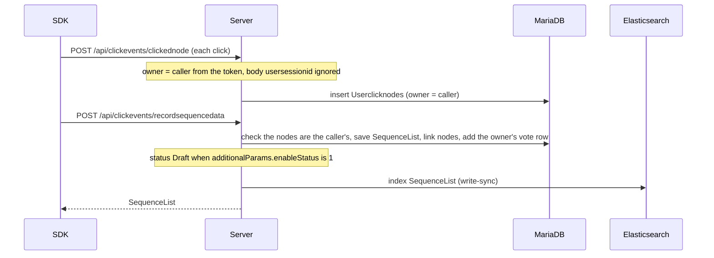

# Flow: record a click sequence

This page shows how a recording travels from the SDK to MariaDB and Elasticsearch, and who owns it. It is for an
engineer who changes recording in the SDK or the Server.

Sources: Server `services/Clickevents.java`, `users/CurrentUser.java`; SDK `src/config/endpoints.ts`.

Updates (`/api/sequence/update`, `/api/clickevents/updateclickednode`) and deletes
(`/api/clickevents/sequence/delete`) take the same path. Indexing is automatic: Hibernate Search writes to
Elasticsearch in the same request.

## Ownership

1. The owner of a recording, click node, vote or click track is the caller from the token (`CurrentUser.ownerKey()`).
2. The owner key is the `authid` for legacy users and the numeric `user_auth_data.id` for all others.
3. A `usersessionid` in a request body, query or path is accepted and ignored.
4. Update, delete and un-vote load the row by id. The Server answers `403` when the caller is not the owner and
   `404` when the id is unknown.
5. `recordsequencedata` accepts only the caller's own click nodes. Click nodes created before migration `V1.0.9`
   have no owner and follow the recording they belong to.

## Read next

- The tables: [Data model](../data-model.md).
- How the token reaches the Server: [Flow: authentication](auth-oidc.md).
- The Server's ownership rules and keys: [Server `README.md`, "Configuration"][server-config].

[server-config]: https://github.com/Digital-Assistant/Digital-Assistant-Server/blob/dev/README.md#configuration
