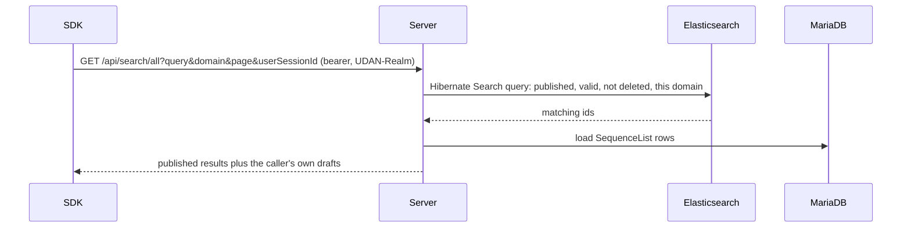

# Flow: search

This page shows how the SDK searches recorded sequences on the Server. It is for an engineer who changes search in
the SDK or the Server.

Sources: Server `services/SearchList.java`, `services/SearchTerms.java`, `RestApplication.java`; SDK
`src/config/endpoints.ts`, `src/services/SearchService.ts`.

## Rules

| Rule | Detail |
|---|---|
| Routes | `/api/search/all`, `/api/search/{id}`, `/api/search/withPermissions[/{id}]` |
| Required parameters | `domain` and `userSessionId`; a missing or blank value gives `400` |
| `userSessionId` | Required but ignored; the caller's drafts come from the token |
| Page size | 10 results; the offset is `page * 10` |
| Owner fields | A result shows its `usersessionid` to its owner only; voter ids are never shown |
| Search terms | `/api/searchTerms/all` returns search-term suggestions from the `clicktrack` index; no public component calls it |

The Client uses a result's `usersessionid` to show the owner's edit and delete controls.

## Read next

- The indexes and filters: [Data model](../data-model.md).
- The token and realm on each request: [Flow: authentication](auth-oidc.md).
